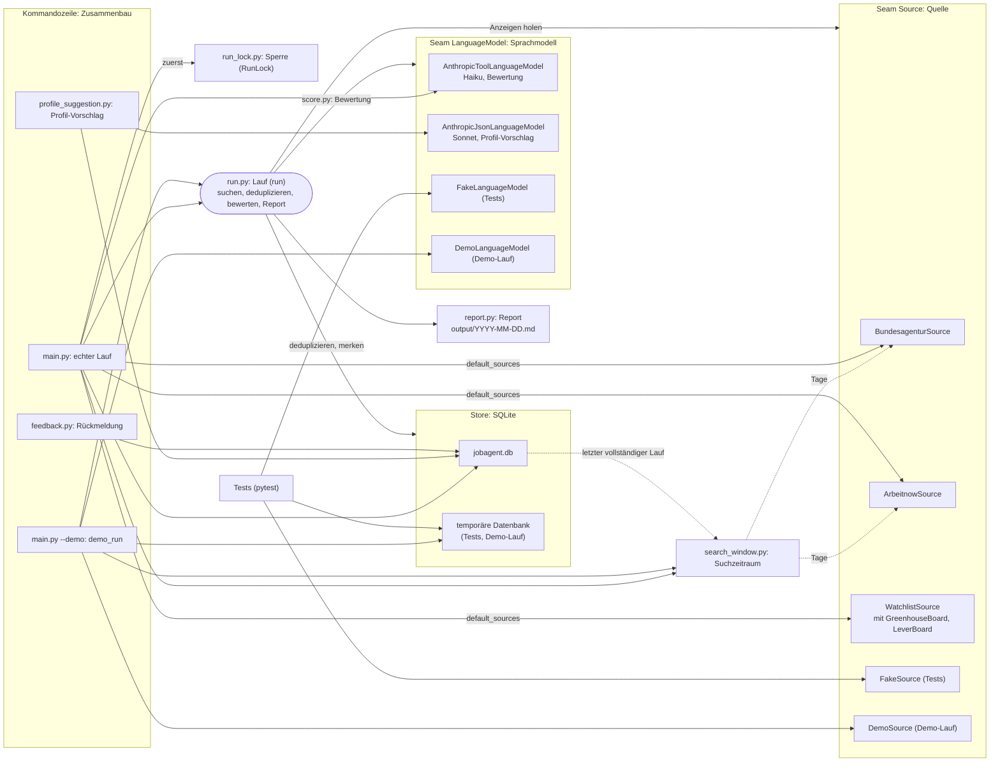

[](https://github.com/bettinawoste-wq/jobagent/actions/workflows/ci.yml)

*A personal agent that searches German job boards and selected company job
boards for new postings, has Claude rate each one against a personal search
profile and writes a ranked Markdown report. It never applies or sends
anything on its own: it only makes suggestions, and every decision stays with
the human. Try it in one command with `--demo`, no API key or network needed.
A small pipeline sits in the middle and talks only to three seams (job sources,
language model, SQLite store), so tests and the demo swap in stand-ins instead
of network and model calls.*

# Job-Agent

Persönlicher Agent, der täglich (bzw. an festgelegten Tagen) neue, passende
Stellenanzeigen sucht, sie gegen ein individuelles Suchprofil bewertet und
eine Markdown-Datei mit den besten Treffern schreibt.

**Wichtig:** Der Agent schickt nie Bewerbungen oder Nachrichten ab — er
liefert ausschließlich Vorschläge zum manuellen Durchsehen.

## Ausprobieren

```bash
uv sync
uv run python -m jobagent.main --demo
```

Der Demo-Lauf zeigt einen vollständigen Report mit erfundenen Anzeigen und
vorgefertigten Bewertungen. Er braucht keinen API-Key, holt nichts aus dem Netz
und liest oder speichert nichts Persönliches; der Report erscheint nur in der
Konsole (mit `--ausgabe ORDNER` zusätzlich als Datei).

Auszug aus der Ausgabe (gekürzt, `…` markiert Auslassungen):

```markdown
# Stellenvorschläge 2026-11-11

Suchzeitraum: 7 Tage (erster Lauf)

## Quellen
- Bundesagentur für Arbeit (Demo): 3 Anzeigen
- Arbeitnow (Demo): 3 Anzeigen
- Firmen-Watchlist (Demo): FEHLER, 2 Anzeigen (Musterwerk AG: Board nicht erreichbar)

## Nachfassen
- Data Engineer (m/w/d) (Datenwerk Muster GmbH): seit 18 Tagen keine Antwort, nachhaken? (beworben am 24.10.2026)

## 1. Full-Stack-Entwickler (m/w/d) Python/TypeScript – Score 5/5
- Firma: Fiktiva Software GmbH
- Ort: Beispielstadt
- Link: https://example.com/stellen/demo-ba-1
- Kurzfazit: Sehr guter Match für die erste Wunschrolle.
- Passt: Python und JavaScript/TypeScript, Full-Stack wie gesucht, Hybrid in Beispielstadt

## 2. Data Scientist (m/w/d) – Score 4/5
- Firma: Lorem Data GmbH
- Ort: Remote
- Link: https://example.com/stellen/demo-an-2
- Kurzfazit: Gute Passung zur vierten Wunschrolle.
- Passt: Data Science mit Python, Remote
- Lücken: scikit-learn nur in Grundzügen

…

## Weitere Treffer (Score unter 3)
- **6.** Werkstudent Data Analytics (m/w/d) (Testfeld Robotics GmbH, Beispielstadt) – Score 2/5: Inhaltlich nah, aber falsches Level. – https://example.com/stellen/demo-wl-2
…

## Bereits beworben
- **8.** Python Developer (w/m/d) (Beispiel Tech, Remote) – Score 4/5 – gespräch, beworben am 07.10.2026 – Text weicht von deiner Bewerbung ab – https://example.com/stellen/demo-an-1
```

Die Watchlist-Quelle fällt im Demo-Lauf absichtlich teilweise aus: So sieht
man, dass eine gescheiterte Quelle den Lauf nicht abbricht, sondern im
Quellenstatus ausgewiesen wird.

## Entscheidungen

Die wichtigsten Grundsatzentscheidungen sind als ADRs in
[`docs/adr/`](docs/adr/) festgehalten:

- [Keine Volltexte von Anzeigen speichern](docs/adr/0001-datensparsamkeit.md):
  Gespeichert werden nur Metadaten, die Bewertung und ein Hash der
  Beschreibung, über den Textabweichungen erkannt werden.
- [Nur Quellen mit öffentlicher Schnittstelle nutzen](docs/adr/0002-nur-erlaubte-quellen.md):
  Bundesagentur, Arbeitnow und Greenhouse/Lever ja, Scraper für LinkedIn,
  Xing oder Indeed nein.
- [Der Mensch entscheidet, der Agent schlägt nur vor](docs/adr/0003-der-mensch-entscheidet.md):
  keine automatischen Bewerbungen, Bewerbungsstatus und Suchprofil ändern sich
  nur durch eigene Angabe bzw. Bestätigung.
- [Haiku für die Bewertung, Sonnet für den Profil-Vorschlag](docs/adr/0004-modellwahl-haiku-sonnet.md):
  das günstige, schnelle Modell für viele kleine Bewertungen, das stärkere für
  den seltenen, anspruchsvollen Profil-Vorschlag.
- [Englische Bezeichner, deutsche Fachsprache](docs/adr/0005-englische-bezeichner-deutsche-fachsprache.md):
  Namen im Code sind englisch nach dem Glossar, alles, was Menschen lesen,
  bleibt deutsch.

## Ablauf

```
Bundesagentur-API   Arbeitnow-API   Firmen-Watchlist
(Suche + Details)   (kein Key)      (Greenhouse/Lever pro Firma)
        │                 │                 │
        └────────┬────────┴─────────┬───────┘
                  ▼
    sources/  ──►  store.py (SQLite-Dedupe: schon gesehene IDs raus)
        │
        ▼
    score.py  ──►  Claude Haiku bewertet jede neue Anzeige
        │          gegen profile.md (strukturierte JSON-Antwort:
        │          score, passt, passt_nicht, luecken, kurzfazit)
        ▼
    report.py ──►  output/YYYY-MM-DD.md (sortiert nach Score)
```

Den Ablauf führt `run.py` aus; was er braucht, baut `main.py` zusammen. Quellen
und Sprachmodell sind Seams mit austauschbaren Adaptern, siehe [Aufbau](#aufbau).

Jeder Schritt ist defensiv: Fällt eine Quelle aus, steht das im Quellenstatus
des Reports. Scheitert die Bewertung einer Anzeige (API-Fehler, ungültige
Antwort des Sprachmodells), wird das geloggt. Der Report zählt die Anzeige dann
als unbewertet, und der nächste Lauf versucht es erneut, sofern eine Quelle sie
noch liefert. Der Gesamtlauf bricht daran nicht ab.

## Aufbau



Weil der Lauf `run` alles übergeben bekommt und nur die Seams kennt, geben ihm die
Tests statt der echten Adapter `FakeSource` und `FakeLanguageModel` aus
`tests/fakes.py` und einen `Store` auf einer temporären SQLite-Datei. So prüfen sie
Suchen, Bewerten, Merken und Report ohne Netz, ohne echtes Sprachmodell und ohne
persönliche Daten. Die echten Quellen testen sie getrennt mit nachgestellten
HTTP-Antworten aus `tests/fixtures/`, und ein Vertragstest am Seam `Source` stellt
sicher, dass keine Quelle wirft.

## Stack

- Python 3.12, Abhängigkeitsverwaltung per [`uv`](https://docs.astral.sh/uv/)
- `httpx` für HTTP-Zugriffe, `sqlite3` (Standardbibliothek) für Dedupe
- [Anthropic SDK](https://github.com/anthropics/anthropic-sdk-python) mit
  Claude Haiku für die Bewertung (strukturierte Antwort per Tool-Use)
- `pytest` (alles gemockt/mit Fixtures, kein Live-Zugriff in Tests),
  `ruff` für Lint/Format und `pyright` (Modus „standard“) für die Typprüfung

## Setup

```bash
uv sync
```

Suchprofil anlegen (wird nicht committed, siehe `.gitignore`):

```bash
cp profile.example.md profile.md
# profile.md mit eigenen Angaben fuellen
```

API-Key setzen (niemals im Code/Repo):

```powershell
[Environment]::SetEnvironmentVariable("ANTHROPIC_API_KEY", "dein-key", "User")
```

Suchparameter in `config.toml` anpassen. Die Datei ist in Abschnitte geteilt:

```toml
[suche]                      # was für alle Quellen, wo/veroeffentlichtseit ohne Watchlist
was = ["Data Scientist", "IT Consultant"]
wo = "München"
veroeffentlichtseit = 7      # Tage (1 bis 100): Start- und Höchstwert des Suchzeitraums

[bundesagentur]
umkreis = 25                 # km

[[watchlist.firmen]]         # optional, je Firma ein Eintrag
name = "GitLab"
ats = "greenhouse"           # oder "lever"
slug = "gitlab"

[report]
mindest_score = 3
nachfassen_ab_tag = 14
nachfassen_bis_tag = 28
```

Der Agent merkt sich jeden vollständigen Lauf, also einen Lauf, in dem jede
Quelle fehlerfrei geliefert hat und keine Anzeige unbewertet blieb. Bundesagentur
und Arbeitnow suchen dann im Suchzeitraum: die Tage seit dem letzten
vollständigen Lauf plus 1, also nach einem vollständigen Lauf am Montag am
Donnerstag 4 Tage. `veroeffentlichtseit` gilt für den ersten Lauf und begrenzt
den Suchzeitraum nach oben; fehlt es, sind es höchstens 100 Tage, mehr nimmt die
Bundesagentur nicht an. Fällt ein Tag aus, eine Quelle aus oder bleibt eine
Anzeige unbewertet, holt der nächste Lauf die Tage seither nach. Ein gemerkter
Lauf mit einem Datum in der Zukunft, etwa nach einer verstellten Uhr, zählt
nicht. Die Watchlist sucht ohne Suchzeitraum.

Ein Hinweis der Quelle im Report ist kein Fehler: Arbeitnow hat keine Suche auf
dem Server und hört nach 10 Seiten auf, das reicht nur für wenige Tage. Der Lauf
kann dann trotzdem vollständig sein. Schneidet dagegen die Bundesagentur
Ergebnisse ab (mehr als 250 Treffer für einen Suchbegriff), ist das ein Fehler;
dann hilft es, den Suchbegriff enger zu fassen.

Fehlende Werte behalten ihren Standard. Unbekannte Abschnitte und Schlüssel,
Werte vom falschen Typ oder außerhalb ihres Bereichs (etwa `mindest_score`
außerhalb der Score-Skala, `nachfassen_ab_tag` nach `nachfassen_bis_tag`, ein
`ats` außer `greenhouse` und `lever`) brechen den Lauf ab; die Meldung nennt
alle Fehler der Datei auf einmal und fragt bei Tippfehlern „meintest du …?“
mit dem ähnlichsten Namen. Das alte flache Format ohne Abschnitte wird nicht
mehr gelesen; der Lauf nennt dann den neuen Platz jedes alten Schlüssels.

## Verwenden

```bash
uv run python -m jobagent.main
```

Ergebnis landet in `output/YYYY-MM-DD.md`, weitere Läufe am selben Tag in
`output/YYYY-MM-DD-2.md` usw. Ein vorhandener Report wird nie überschrieben.
Die Treffer sind je Report ab 1 durchnummeriert. Oben im Report steht der
Suchzeitraum und je Quelle, wie viele Anzeigen sie geliefert hat und ob sie ausgefallen ist.
Treffer unter `mindest_score` (`[report]` in `config.toml`, Standard 3) erscheinen nur
einzeilig am Ende.
Ohne neue Treffer wird eine kurze Notiz statt einer leeren Datei geschrieben.

## Rückmeldung geben

Treffer werden über Report und Nummer angesprochen:

```bash
uv run python -m jobagent.feedback 2026-11-06 3 beworben
uv run python -m jobagent.feedback 2026-11-06 3 beworben --am 2026-11-01
uv run python -m jobagent.feedback 2026-11-06 3 gespräch
uv run python -m jobagent.feedback 2026-11-06 2 score 4 "Dienstleister ist okay"
```

Status sind `beworben`, `gespräch`, `absage`, `zusage` und `zurückgezogen`;
`zurücknehmen` löscht eine versehentlich erfasste Bewerbung. Der Status ändert
sich nur durch solche Angaben, nie von selbst.

Bewerbungen ohne Treffer (z. B. direkt auf einer Karriereseite) gehen so:

```bash
uv run python -m jobagent.feedback beworben --firma "Firma X" --titel "Data Engineer"
```

Steht eine Bewerbung auf `beworben` und liegt 14 bis 28 Tage zurück
(`nachfassen_ab_tag`, `nachfassen_bis_tag` unter `[report]` in `config.toml`), erinnert der
Report ans Nachhaken. Danach verschwindet der Hinweis, der Status bleibt.

Erscheint eine Stelle erneut, auf die du dich beworben hast, steht sie im
Report im Block „Bereits beworben“, mit Status, Datum und dem Hinweis, ob der
Text von dem bei deiner Bewerbung abweicht. Dieselbe Stelle heißt: gleiche Firma
und gleicher Titel, unabhängig von Schreibweise, (m/w/d) und Rechtsform.

## Suchprofil aus Feedback verbessern

```bash
uv run python -m jobagent.profile_suggestion
```

Claude Sonnet wertet das noch offene Feedback aus und unterscheidet dabei
Lücken im Profil von Lesefehlern der Bewertung. Du siehst die Änderungen als
Diff und entscheidest: übernehmen, ablehnen oder abbrechen. Vor dem Übernehmen
wird eine Sicherung `profile.sicherung-….md` angelegt. Ab 5 offenen
Rückmeldungen erinnert der Report daran.

## Tests

```bash
uv run pytest
uv run ruff check . && uv run ruff format .
uv run pyright
```

## Automatisierung

Lässt sich z. B. per Windows Task Scheduler (`Register-ScheduledTask`) oder
cron an bestimmten Wochentagen morgens automatisch starten. Das Log eines Laufs
bleibt dabei erhalten: Es liegt neben dem Report und heißt wie er
(`output/YYYY-MM-DD.log`). Bricht ein Lauf ganz ab, gibt es keinen Report; sein Log
samt Traceback landet dann in `output/abgebrochen.log`. Diese Datei wächst auf etwa
1 MB; danach wird sie zu `output/abgebrochen.log.1`, und eine noch ältere Kopie
fällt weg. Lässt sich diese Kopie nicht anlegen, wächst die Datei mit einer Warnung
auf der Konsole weiter, statt ältere Läufe zu verlieren.

Startet ein Lauf, während noch einer läuft (etwa Zeitplan und Handstart), bricht der
zweite mit einer Meldung und Exit-Code 1 ab, bevor er sucht oder bewertet. Die Sperre
hängt an `jobagent.db.runlock` neben der Datenbank und löst sich mit dem Ende des Laufs,
auch nach einem Absturz; die Datei selbst darf liegen bleiben. Die Meldung nennt
die Sperrdatei: Unter Windows erscheint auch eine kaputte Sperrdatei so, die man
dann löschen kann, wenn sicher kein anderer Lauf läuft. Rückmeldung und
Profil-Vorschlag sind währenddessen weiter möglich.

Wer selbst `ANTHROPIC_LOG=debug` setzt, bekommt vom SDK von Anthropic dessen
Anfragen samt Anzeigen-Volltext auf die Konsole. Die Log-Dateien des Agenten bleiben
davon unberührt: Sie nehmen von fremden Bibliotheken nichts unter INFO auf
([ADR 0001](docs/adr/0001-datensparsamkeit.md)).

## Änderungen

Was sich von Version zu Version geändert hat, steht im
[`CHANGELOG.md`](CHANGELOG.md).

## Hinweis zur Entstehung

Dieses Projekt ist iterativ mit [Claude Code](https://claude.com/claude-code)
entstanden (KI-Pair-Programming): Architektur und Vorgaben kamen aus
`CLAUDE.md`, jeder Schritt wurde einzeln geplant, implementiert, getestet und
committed. Dabei wurden auch reale Bugs gefunden und gefixt, zum Beispiel ein
Abweichen der Live-API vom dokumentierten Schema und ein nicht abgefangener
Fehlertyp bei fehlendem API-Key — beide erst durch echte End-to-End-Läufe
aufgefallen, nicht durch die Unit-Tests allein.
